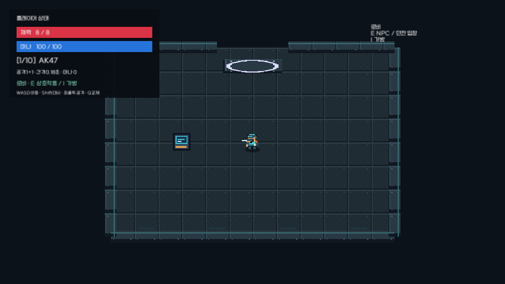
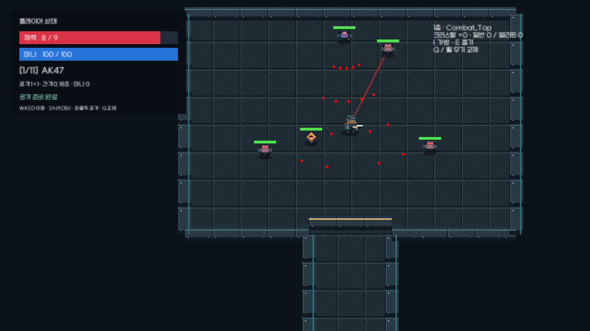

# 임시 그래픽과 애니메이션

플레이하면 로비·룸시스템·샘플 씬에 임시 픽셀 그래픽을 자동 적용한다.
청록색 방호복, 주황색 장비 포인트, 어두운 금속 시설을 공통 팔레트로 사용한다.
씬 편집 화면의 원본 오브젝트·스프라이트·충돌체는 유지하며 런타임에 시각 자식을 만든다.
외부 이미지 다운로드나 추가 패키지 없이 코드로 생성한 작은 텍스처를 공유한다.

## 적용 내용

- 플레이어: 생존자 스프라이트, 4프레임 걷기, 숨쉬기, 작은 흔들림, 지면 그림자.
- 대시: 청록색 잔상. 몸체와 콜라이더의 위치·크기에는 추가 변형을 주지 않는다.
- 무기: 총기·발사기·근접 무기·마법 무기의 임시 외형, 조준 방향에 따른 반전, 반동.
- 공격: 발사광, 근접 공격 궤적, 탄환과 마법탄, 비행 잔상, 폭발 원형 파동.
- 피격: 짧은 붉은 점멸과 작은 파편, 플레이어 무적 시간 점멸.
- 몬스터: 근접·원거리·자폭형 실루엣 구분, 걷기, 피격 파편, 사망 파편과 파동.
- 아이템: 크리스탈·회복약·무기 외형, 그림자와 부유 애니메이션, 획득 효과.
- 공간: 반복 금속 바닥·벽, 평면 바닥 환기구, 벽 가장자리와 문 경고색, 강화 단말기, 입구 표시.
- 카메라: 플레이어 피격 시 짧고 약한 흔들림.

시각 효과는 별도의 난수 발생기를 사용하고, 동시에 살아 있는 효과 수를 제한한다.
전투 수치, 드랍 확률, 가방, 저장 규칙, 씬 전환은 변경하지 않는다.
방 안개와 기존 스프라이트 정렬 기준을 유지한다.

## 정식 리소스 교체

`Assets/Resources/PrototypeVisualTheme.asset`에서 설정한다.

- `Use Prototype Visuals`: 끈 뒤 플레이를 다시 시작하면 원래 그래픽으로 돌아간다.
- `Camera Shake`: 카메라 흔들림만 끈다.
- `Player Walk`, `Monster Walk`: 정식 스프라이트를 배열에 넣으면 프레임을 순환한다. 비워두면 임시 그래픽이다.
- `Floor Tile`, `Wall Tile`: 정식 반복 타일로 교체한다. 타일은 Full Rect, Point 필터를 권장한다.

몸체의 시각 자식만 움직이므로 실제 이동·물리 콜라이더를 애니메이션해서는 안 된다.
정식 Animator를 연결할 때는 `PrototypeActorVisual`의 몸체 자식 생성·갱신 부분을 대체한다.
`AttackPerformed`, `Damaged` 이벤트는 정식 애니메이션과 이펙트에도 사용할 수 있다.

## 확인

로비에서 이동·대시하고, 던전에서 무기를 바꿔가며 공격·피격·아이템 획득을 확인한다.
가방을 열면 애니메이션·이펙트도 전투 시간과 함께 정지한다.
`./Tools/CombatValidation/Run.ps1 -CapturePreview`는 실제 씬 기능을 검증하고
`Temp/CombatValidation/Preview/lobby.png`, `dungeon.png`를 렌더링한다.

검증 결과: 빌드 오류·경고 0개, 기존 기능과 시각 자식·충돌체 보존 검증 355개 통과.
실제 Unity 플레이 모드 렌더링을 보면서 캐릭터 크기, 비활성 문의 외형, 그림자 정렬을 확인했다.

